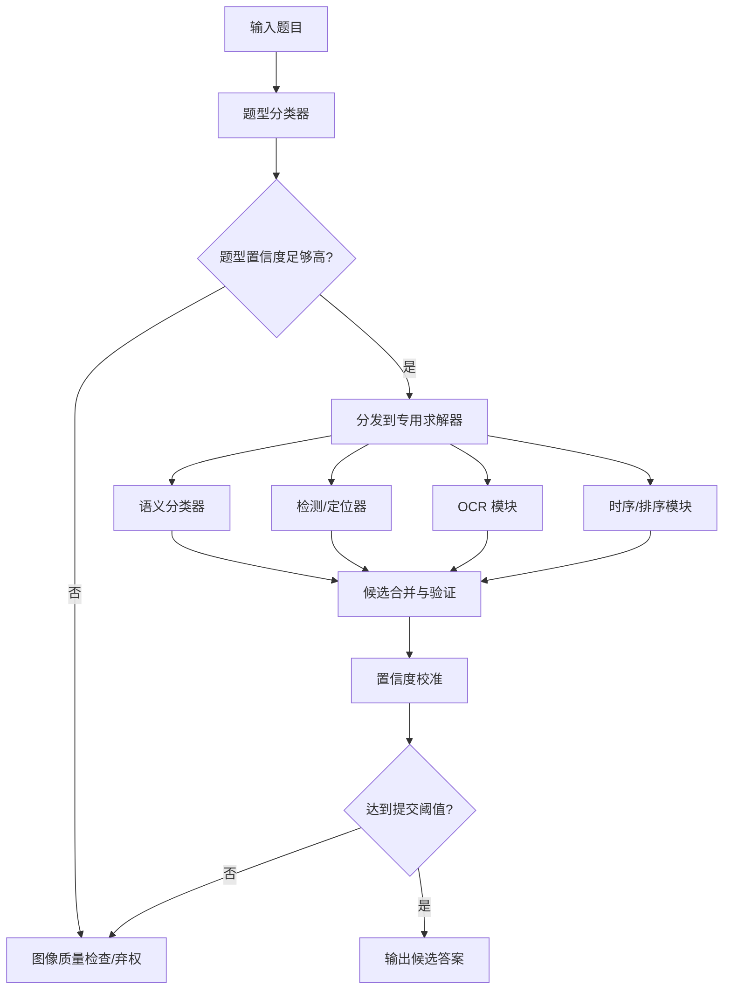

> 理论基础第 1 篇：先定义问题，再决定模型。图像挑战不是一个静态分类任务，而是数据、题型、置信度和会话目标的组合。

## 摘要

FunCaptcha 风格挑战常被误认为“训练一个 CNN 认图”即可解决。真正困难的地方在于：题型会变化，样本会漂移，单次决策成本较高，错误代价不对称，而且图像识别只占完整挑战链路的一部分。

本文把图像挑战识别拆成四个基础问题：

1. 任务边界是什么：看图、完成挑战和会话成功分别意味着什么；
2. 题型如何分类：语义选择、目标定位、空间关系、OCR 与时序交互如何路由；
3. 数据如何构建：如何避免同源泄漏、模板泄漏和答案泄漏；
4. 模型如何设计：什么时候用分类器、检测器、OCR 或多模型组合。

> **研究边界**：本文讨论授权环境中的视觉识别评测、工程建模和系统设计，不提供针对第三方站点的绕过代码、凭证伪造方法或完整攻击方案。

---

## 1. 先给结论

FunCaptcha 风格挑战的识别，不应被描述为“训练一个 CNN 认图”。更准确的定义是：

> 在一个题型动态变化、样本分布持续漂移、单次决策成本较高、错误代价不对称的环境中，构建一个能够**识别题型、提取结构、输出候选、估计置信度并在不确定时弃权**的视觉决策系统。

这意味着四个工程判断：

1. **题型路由优先于单一模型。** 语义选择、目标定位、短文本识别和空间排序，不适合强行共用一个输出头。
2. **数据切分优先于模型调参。** 同一会话、同一模板、同一帧序列的样本必须放在同一个 split，否则指标会虚高。
3. **校准优先于堆叠模型。** 一个能可靠说“我不确定”的小模型，通常比一个过度自信的大模型更适合生产。
4. **会话级指标优先于图片级指标。** 业务真正关心的是挑战完成率、误放行率、延迟和成本。

---

---

## 2. 问题边界与任务定义

### 2.1 “看懂”与“完成”不是一回事

在本文语境中，至少有三个不同层次的任务：

| 层次 | 输入 | 输出 | 典型问题 |
|---|---|---|---|
| 视觉理解 | 一张题目图 | 目标类别、位置或文本 | 图片模糊、目标遮挡、类别长尾 |
| 交互决策 | 多帧图像 + 当前状态 | 下一步操作或最终提交 | 顺序、拖拽终点、重试时机 |
| 会话完成 | 题目、凭证、业务上下文 | 一次可被服务端校验的结果 | 过期、重复、策略拒绝、网络抖动 |

只优化第一层，往往会在第二层和第三层失败。例如模型正确识别了目标，但提交顺序错误；或者客户端拿到了短期凭证，业务服务端却因会话不匹配而拒绝。

### 2.2 成功指标必须先定义

不要直接使用“准确率”作为唯一目标。建议至少定义以下指标：

- **图片级准确率**：单张图或单个子任务的答案是否正确。
- **挑战级成功率**：一次完整挑战从下发到服务端校验通过的比例。
- **误接受率（False Accept Rate）**：错误答案被系统当成正确答案的比例，尤其适用于负样本评测。
- **弃权率（Abstention Rate）**：模型因低置信度主动不提交的比例。
- **端到端延迟**：从挑战下发到业务服务端收到校验结果的时间。
- **单次成功成本**：模型推理、重试、人工回退和基础设施成本之和。
- **用户放弃率**：挑战过长、过慢或反复失败导致的流失。

这些指标之间存在张力。提高阈值可以降低误接受率，但会增加弃权率和人工成本；扩大模型可以提升精度，但可能破坏延迟预算。上线前应把张力显式写进目标，而不是上线后再争论。

### 2.3 错误代价不对称

把“错误答案提交上去”与“低置信度时请求人工处理”视为同一种失败，是常见的建模错误。生产中通常更希望：

```text
高置信度正确  > 低置信度弃权  > 高置信度错误
```

因此，模型输出不应只有类别，还应包含：

- 题型预测及其置信度；
- 目标候选及其置信度；
- 当前图像质量评分；
- 是否需要重新采集/回退；
- 可解释的失败原因编码。

---

---

## 3. 题型分类：不要假设只有一种图

FunCaptcha 及类似挑战的形态会随版本、风险等级、语言和设备变化。工程上不要把某一种历史题型写死为“全部协议”，而应建立可扩展的题型注册表。

### 3.1 常见挑战族

| 挑战族 | 视觉任务本质 | 推荐建模方式 | 主要难点 |
|---|---|---|---|
| 语义选择 | 从多张图中选出符合描述的目标 | 多标签分类 + 目标检测 | 语义歧义、相似干扰项 |
| 目标定位 | 找到指定物体的位置 | 检测/分割/热力图 | 小目标、遮挡、背景干扰 |
| 空间关系 | 判断位置、方向、排列或配对 | 关系建模 + 排序 | 视角变化、规则组合 |
| 短文本/数字 | 读取并输入短字符串 | OCR + 字符级校验 | 字体变形、粘连、噪声 |
| 序列交互 | 按步骤选择、拖拽或旋转 | 状态机 + 时序模型 | 中间状态不可见、误差累积 |
| 动态/多帧 | 从变化过程中提取线索 | 视频分类/时序 Transformer | 帧间一致性、延迟和存储 |

### 3.2 题型路由器

推荐采用两级结构：



题型路由器的价值不只是提高精度，还能降低推理成本：简单题型走轻量模型，复杂题型再调用大模型或多模型集成。

### 3.3 不要把“题型标签”当成永久契约

建议题型注册表包含：

```json
{
  "family": "semantic_select",
  "version": "2026-01",
  "input_schema": "image_array+instruction",
  "output_schema": "index_set",
  "supports_multi_frame": false,
  "min_confidence": 0.82
}
```

当上游题型变化时，系统可以：

- 新题型进入 `unknown` 路由，而不是被错误地送入旧模型；
- 对旧模型保留版本化阈值；
- 在监控中按 `family + version` 切片；
- 通过影子模式评估新模型，而不是直接替换。

---

---

## 4. 数据工程：决定上限的部分

### 4.1 数据契约

训练数据应尽量保存为“可复现的实验资产”，而不是散落的图片文件夹。一个可用的样本契约如下：

```json
{
  "sample_id": "sha256:8f4c...",
  "session_id_hash": "sha256:1a2b...",
  "template_family": "semantic_select",
  "template_version": "2026-01",
  "asset_uri": "s3://authorized-bucket/challenges/000123.webp",
  "instruction": "选择所有包含指定物体的图片",
  "labels": [
    {"role": "positive", "index": 0, "bbox": [0.12, 0.18, 0.44, 0.71]},
    {"role": "negative", "index": 1}
  ],
  "answer": {"indices": [0, 3]},
  "captured_at": "2026-01-15T10:20:30Z",
  "locale": "zh-CN",
  "device_class": "desktop",
  "split": "train"
}
```

关键原则：

- `session_id_hash` 用于分组切分，不直接保存原始会话标识；
- `asset_uri` 指向受控存储，不把图片二进制塞进 JSON；
- `template_family` 与 `template_version` 分开，便于分析漂移；
- `answer` 只存在于授权训练环境，生产推理日志不应记录标准答案；
- `captured_at` 支持时间外推测试，避免只用随机切分评估。

### 4.2 标注质量

图像挑战的标签往往不是简单的 0/1。需要明确：

1. **单标签还是多标签**：多目标选择必须支持多个正样本。
2. **目标边界是否重要**：分类任务可以没有 bbox，定位任务必须有。
3. **答案是否唯一**：某些题目允许等价答案，应记录 `acceptable_answers`。
4. **不确定样本如何处理**：不要强行把模糊样本标成确定类别，应设置 `uncertain` 并由第二人复核。
5. **双人标注与仲裁**：抽检关键题型，计算标注者一致性；分歧样本进入仲裁集。

建议维护一个“难例账本”：

```text
sample_id | 失败类型 | 模型输出 | 正确输出 | 是否可修复 | 备注
```

这张表比单纯增加数据量更能指导下一步工作。

### 4.3 数据切分的三个陷阱

#### 陷阱一：随机切分导致同源泄漏

同一挑战会话可能产生多帧、多裁剪或多张相似图片。随机切分后，训练集和验证集会共享几乎相同的视觉内容。正确做法是按 `session_id_hash` 分组切分，并在必要时按日期切分。

#### 陷阱二：模板泄漏

同一模板生成的图片在背景、边框、字体上高度相似。应按 `template_family + template_version` 做分组，确保验证集包含模型未见过的模板版本。

#### 陷阱三：答案泄漏

文件名、目录名、EXIF、标注文件路径中可能包含答案。训练前应做一次“泄漏审计”，确认模型没有通过元数据走捷径。

### 4.4 分布漂移监控

至少监控以下切片：

- 题型分布；
- 图像尺寸、压缩格式和清晰度；
- 语言/地区；
- 设备类别；
- 模板版本；
- 挑战步骤数；
- 模型置信度分布；
- 失败原因分布。

当某个切片的样本量突然下降或置信度分布明显偏移时，应先排查数据采集和上游版本变化，而不是立即重训模型。

---

---

## 5. 模型设计：从基线到组合系统

### 5.1 模型选型矩阵

| 方案 | 适合任务 | 优点 | 局限 |
|---|---|---|---|
| MobileNetV3 / EfficientNet-B0 | 轻量分类基线 | 延迟低、部署简单 | 复杂语义和细粒度目标较弱 |
| ConvNeXt-T / ViT-B | 细粒度分类 | 表达能力强 | 数据和算力要求更高 |
| YOLO 系列 / DETR 类 | 目标定位 | 可直接输出位置 | 小目标和重叠目标仍困难 |
| CRNN / PARSeq 类 | 短文本识别 | 成熟、可解释 | 字体变形和粘连需要专门增强 |
| 时序 Transformer / GRU | 多帧与交互序列 | 能利用帧间信息 | 需要序列级标签和更高延迟 |
| 路由 + 专用模型 + 验证器 | 混合题型 | 精度与成本可控 | 工程复杂度最高 |

建议从“轻量分类器 + 题型路由 + 置信度门控”开始，而不是一开始就追求端到端大模型。端到端模型很难定位错误来源，也不利于按题型做回归测试。

### 5.2 多任务还是多模型

可以把题型识别、目标分类和目标定位放在一个多任务网络中，但要注意任务冲突：

- 分类任务偏好全局语义，定位任务偏好局部细节；
- 不同题型的标签空间可能不兼容；
- 某个任务的数据量很少时，共享主干可能被大任务主导。

实用策略：

1. 共享视觉主干；
2. 使用轻量题型头；
3. 为不同挑战族设置独立输出头；
4. 对样本量极小的题型使用独立小模型；
5. 用验证器检查输出是否符合题目约束。

### 5.3 置信度与弃权

模型输出的 softmax 概率不等于真实正确概率。上线前应做校准：

- 在独立校准集上拟合温度缩放（temperature scaling）；
- 按题型分别校准，而不是全库一个温度；
- 使用 bootstrap 估计阈值附近的置信区间；
- 记录“置信度—实际正确率”曲线；
- 对分布外样本设置专门的 OOD 检测或质量门控。

一个简单的决策策略：

```python
candidate = model.predict(image)
calibrated = calibrator[candidate.family].transform(candidate.confidence)

if image_quality < QUALITY_FLOOR:
    return abstain("LOW_QUALITY")
if candidate.family_confidence < FAMILY_FLOOR:
    return abstain("UNKNOWN_FAMILY")
if calibrated < family_threshold:
    return abstain("LOW_CONFIDENCE")
return submit(candidate.answer)
```

阈值不应凭直觉设置。应通过验证集上的代价曲线选择：

```text
总成本 = 错误接受成本 × FAR
       + 弃权成本 × AbstentionRate
       + 推理成本 × RequestCount
       + 延迟惩罚
```

如果业务对误接受极其敏感，应提高阈值并接受更高弃权率；如果主要目标是减少人工工作量，则可以在可审计的前提下调整阈值。

### 5.4 验证器与一致性检查

对多步挑战，建议在输出前增加规则验证器：

- 选择数量是否在允许范围内；
- 目标框是否落在图像有效区域；
- 拖拽终点是否满足方向/距离约束；
- OCR 结果是否符合字符集和长度；
- 多帧答案是否时序一致；
- 输出是否违反题型 schema。

验证器不能替代视觉模型，但可以拦截大量低级错误，降低无效提交和服务端拒绝率。

---

---

## 本篇小结

图像挑战识别的第一个理论点，是把“识别”从单张图片中抽离出来：

- 先定义会话级目标，再定义图片级指标；
- 先建立题型路由，再讨论单一模型的上限；
- 先保证数据切分正确，再追求更高的测试集准确率；
- 先设计可弃权的决策系统，再追求“全部自动完成”。

下一篇将进入训练、推理编排和评测体系，讨论如何把这些原则落到一条可复现的工程链路中。

---

*说明：本文讨论授权范围内的人机验证视觉任务与工程评测方法；具体产品能力、接口和实现以官方文档、合同及当地法律为准。*
