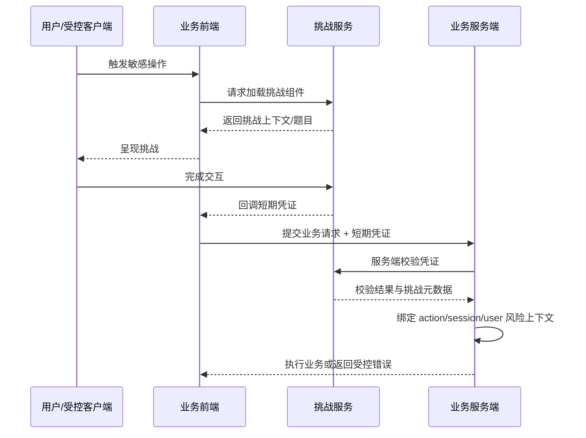

> 理论基础第 3 篇：识别模型决定“能否看懂题目”，协议工程决定“能否在正确的信任边界内完成一次挑战”。

## 摘要

图像识别只是链路中的一个决策节点。真正把挑战送入业务系统的，是状态、凭证、校验、重试、日志和审计。

本文讨论：

- 客户端、挑战服务和业务服务端的三层信任结构；
- 挑战生命周期状态机与不变量；
- 短期凭证的作用域、上下文绑定和一次性消费；
- 网络错误、过期、重放和限流的重试语义；
- 结构化日志、指标、告警和测试策略；
- 站点所有者应如何设计防御和降级路径。

> **研究边界**：本文讨论公开可验证的协议设计模式和授权环境中的工程集成，不披露第三方产品未公开的接口细节、签名算法或绕过步骤。

---

## 1. 先给结论

在验证码/人机挑战系统中，“协议”不是几行请求参数，而是一组跨客户端和服务端的契约：

- 谁负责加载挑战；
- 谁生成挑战上下文；
- 谁验证短期凭证；
- 凭证何时过期；
- 失败后能否重试；
- 哪些信息可以记录，哪些必须立即丢弃；
- 如何证明一次成功属于当前用户、当前动作和当前会话。

如果只实现“页面出现验证码 → 用户点击 → 前端显示成功”，系统通常会在以下场景崩溃：

- 高峰期接口超时，用户重复点击产生多次校验；
- 客户端显示成功，服务端却因 token 过期或重放而拒绝；
- 同一 token 被并发请求使用；
- 业务日志意外记录了完整 token；
- 上游限流时系统无限重试，进一步放大故障；
- 新版本挑战组件上线后，旧的前端选择器或字段假设失效。

本文用状态机、数据契约、重试矩阵和可观测性设计，把这些隐性问题显式化。

---

---

## 2. 研究范围与信任边界

### 2.1 三层结构

FunCaptcha 风格的集成通常可以抽象为三层：

| 层 | 主要职责 | 不应承担的责任 |
|---|---|---|
| 客户端集成层 | 加载挑战组件、呈现题目、接收回调、传递短期凭证 | 独立决定业务是否放行 |
| 挑战服务层 | 下发题目、维护挑战状态、评估交互信号、签发/验证凭证 | 决定业务权限和账户权益 |
| 业务服务端 | 校验凭证、绑定业务动作、执行授权、记录审计事件 | 信任客户端自报的“成功”布尔值 |



### 2.2 公开集成契约与内部信号

必须区分两类信息：

1. **公开集成契约**：官方文档允许开发者使用的加载方式、回调事件、服务端校验接口和错误码。
2. **内部反滥用信号**：设备指纹、行为评分、风险模型、私有挑战策略等。

本文只讨论第一类和抽象的工程模式。不要尝试伪造签名、提取内部密钥、修改挑战脚本或绕过服务端策略。协议研究的目的应是提高集成可靠性，而不是破坏信任边界。

### 2.3 信任原则

一句话原则：

> 浏览器可以提交“证据”，但只有业务服务端可以得出“结论”。

客户端传来的任何字段都可能被篡改。前端成功回调只能作为“用户可能完成了挑战”的信号，不能作为授权依据。

---

---

## 3. 挑战生命周期状态机

### 3.1 推荐状态

```text
INIT
  -> LOADING
  -> READY
  -> CHALLENGE_ISSUED
  -> INTERACTING
  -> TOKEN_RECEIVED
  -> SERVER_VERIFYING
  -> SUCCESS
  -> FAILED
  -> EXPIRED
  -> ABORTED
  -> RATE_LIMITED
```

其中 `SUCCESS`、`FAILED`、`EXPIRED`、`ABORTED`、`RATE_LIMITED` 是终止状态；是否允许从终止状态重新进入 `INIT`，由业务的重试策略决定。

### 3.2 状态迁移表

| 当前状态 | 事件 | 下一状态 | 约束 |
|---|---|---|---|
| INIT | 开始加载 | LOADING | 生成 correlation_id |
| LOADING | 组件就绪 | READY | 在加载超时内 |
| LOADING | 超时/资源失败 | FAILED | 记录可重试错误 |
| READY | 挑战下发 | CHALLENGE_ISSUED | 保存 challenge_id，不记录 token |
| CHALLENGE_ISSUED | 用户开始交互 | INTERACTING | 只有一个活动会话 |
| INTERACTING | 客户端回调成功 | TOKEN_RECEIVED | token 仅短时持有 |
| INTERACTING | 用户取消/超时 | ABORTED/EXPIRED | 清理本地状态 |
| TOKEN_RECEIVED | 提交服务端 | SERVER_VERIFYING | 防止并发重复提交 |
| SERVER_VERIFYING | 校验通过 | SUCCESS | 绑定 action/session |
| SERVER_VERIFYING | 校验拒绝 | FAILED | 分类错误，不盲目重试 |
| SERVER_VERIFYING | 服务端超时 | SERVER_VERIFYING | 仅对幂等安全场景有限重试 |
| READY/CHALLENGE_ISSUED | 触发限流 | RATE_LIMITED | 退避或人工回退 |

### 3.3 状态机的三个不变量

1. **单活动会话**：同一业务动作在同一时刻最多有一个进行中的挑战会话。
2. **单次消费**：一次成功凭证只能用于一次服务端校验和一个业务动作。
3. **可终止**：任何状态都必须有超时、取消或人工回退路径。

### 3.4 TypeScript 骨架

下面是一个不依赖具体厂商字段的状态机骨架，用于说明工程结构，而不是可直接用于绕过第三方系统的客户端脚本：

```ts
type ChallengeState =
  | "INIT"
  | "LOADING"
  | "READY"
  | "CHALLENGE_ISSUED"
  | "INTERACTING"
  | "TOKEN_RECEIVED"
  | "SERVER_VERIFYING"
  | "SUCCESS"
  | "FAILED"
  | "EXPIRED"
  | "ABORTED"
  | "RATE_LIMITED";

type ChallengeEvent =
  | { type: "LOAD" }
  | { type: "LOADED" }
  | { type: "ISSUED"; challengeId: string }
  | { type: "INTERACT" }
  | { type: "TOKEN"; token: string }
  | { type: "VERIFY" }
  | { type: "VERIFIED"; ok: true }
  | { type: "REJECTED"; code: string }
  | { type: "TIMEOUT" }
  | { type: "ABORT" }
  | { type: "RATE_LIMIT" };

interface TransitionResult {
  state: ChallengeState;
  retryable: boolean;
  reason?: string;
}

export function transition(
  state: ChallengeState,
  event: ChallengeEvent,
): TransitionResult {
  switch (`${state}:${event.type}`) {
    case "INIT:LOAD":
      return { state: "LOADING", retryable: false };
    case "LOADING:LOADED":
      return { state: "READY", retryable: false };
    case "LOADING:TIMEOUT":
      return { state: "FAILED", retryable: true, reason: "LOAD_TIMEOUT" };
    case "READY:ISSUED":
      return { state: "CHALLENGE_ISSUED", retryable: false };
    case "CHALLENGE_ISSUED:INTERACT":
      return { state: "INTERACTING", retryable: false };
    case "INTERACTING:TOKEN":
      return { state: "TOKEN_RECEIVED", retryable: false };
    case "TOKEN_RECEIVED:VERIFY":
      return { state: "SERVER_VERIFYING", retryable: false };
    case "SERVER_VERIFYING:VERIFIED":
      return { state: "SUCCESS", retryable: false };
    case "SERVER_VERIFYING:REJECTED":
      return { state: "FAILED", retryable: false, reason: event.code };
    case "SERVER_VERIFYING:TIMEOUT":
      return { state: "SERVER_VERIFYING", retryable: true, reason: "VERIFY_TIMEOUT" };
    case "CHALLENGE_ISSUED:TIMEOUT":
    case "INTERACTING:TIMEOUT":
      return { state: "EXPIRED", retryable: true, reason: "CHALLENGE_TIMEOUT" };
    case "CHALLENGE_ISSUED:RATE_LIMIT":
    case "INTERACTING:RATE_LIMIT":
      return { state: "RATE_LIMITED", retryable: true, reason: "RATE_LIMITED" };
    default:
      return { state, retryable: false, reason: "INVALID_TRANSITION" };
  }
}
```

生产实现还应加入：

- 每个状态的截止时间；
- 事件去重键；
- 并发锁；
- token 的短时内存存储；
- 页面关闭和网络断开时的清理逻辑；
- 结构化错误码；
- 业务动作与服务端校验结果的绑定。

---

---

## 4. 数据契约

### 4.1 配置契约

```yaml
human_challenge:
  provider: funcaptcha
  public_key_env: FUNCAPTCHA_PUBLIC_KEY
  site: example.com
  locale: zh-CN
  load_timeout_ms: 15000
  challenge_timeout_ms: 120000
  verify_timeout_ms: 5000
  max_transient_retries: 2
  retry_base_delay_ms: 500
  retry_max_delay_ms: 8000
  max_concurrent_sessions: 1
```

配置原则：

- 公钥从环境变量或密钥管理系统读取，不硬编码到前端仓库；
- 超时是业务 SLA 的一部分，不是随手写的魔法数字；
- 重试次数与退避上限必须可配置；
- 本地化语言与站点要显式记录，便于复现问题；
- 不在配置中保存服务端私钥或长期凭据。

### 4.2 事件契约

```json
{
  "event_id": "evt_01J...",
  "correlation_id": "corr_01J...",
  "session_id_hash": "sha256:...",
  "challenge_id": "ch_...",
  "event_type": "challenge_verified",
  "provider": "funcaptcha",
  "provider_version": "2026-01",
  "action": "account_recovery",
  "result": "success",
  "latency_ms": 842,
  "error_code": null,
  "occurred_at": "2026-01-15T10:20:30Z"
}
```

事件中不应出现：

- 完整 token；
- 原始 Cookie；
- 未脱敏的用户标识；
- 完整题目图像（除非有明确保留授权和加密存储）；
- 可重放的挑战上下文；
- 生产环境密钥。

### 4.3 校验接口的抽象

不同版本的挑战服务可能提供不同的校验接口和字段。不要在文章或代码中假设某个固定 URL、字段顺序或响应结构。更稳妥的做法是定义内部适配器：

```ts
export interface VerificationInput {
  token: string;
  challengeId: string;
  action: string;
  sessionIdHash: string;
  remoteIpHash?: string;
}

export type VerificationResult =
  | { ok: true; challengeId: string; score?: number }
  | {
      ok: false;
      code:
        | "INVALID"
        | "EXPIRED"
        | "REPLAY"
        | "ACTION_MISMATCH"
        | "RATE_LIMITED"
        | "UPSTREAM_UNAVAILABLE"
        | "UPSTREAM_TIMEOUT";
    };

export interface ChallengeVerifier {
  verify(input: VerificationInput): Promise<VerificationResult>;
}
```

适配器内部再调用官方文档指定的服务端接口。这样做有三个好处：

- 版本变化时只修改适配器；
- 业务服务不依赖厂商的原始响应结构；
- 测试可以注入 fake verifier，验证失败分支。

### 4.4 服务端校验必须绑定上下文

仅校验 token 是否有效还不够。建议同时检查：

- token 是否属于当前 challenge_id；
- 是否与当前业务 action 匹配；
- 是否属于当前会话或用户；
- 是否已消费；
- 是否在允许的时间窗口内；
- 请求是否来自可接受的网络与设备环境；
- 是否为异常高频或跨账号复用。

具体绑定字段取决于官方能力和隐私要求。原则是：**不要把“全局有效的 token”当作“当前动作的授权”。**

---

---

## 5. 重试语义：不要把所有失败都当成网络错误

### 5.1 失败分类矩阵

| 失败类型 | 示例 | 是否重试 | 推荐动作 |
|---|---|---|---|
| 瞬时网络错误 | DNS 抖动、连接重置 | 是，有限次 | 指数退避 + 抖动 |
| 上游超时 | 校验接口未在 SLA 内返回 | 谨慎 | 使用幂等键，避免重复消费 token |
| 挑战过期 | 用户停留过久 | 是 | 重新下发挑战 |
| 无效 token | 参数错误、上下文不匹配 | 否 | 记录错误码，提示重新挑战 |
| token 重放 | 同一 token 再次提交 | 否 | 拒绝并告警 |
| 限流 | 429/策略限流 | 是，带退避 | 降低并发，必要时熔断 |
| 策略拒绝 | 风险过高 | 否 | 人工审核或其他安全流程 |
| 用户取消 | 页面关闭、主动退出 | 否 | 清理状态，允许用户重新发起 |

### 5.2 退避策略

推荐使用带抖动的指数退避：

```text
delay = min(max_delay, base_delay × 2^attempt)
jittered = random(0.5 × delay, 1.5 × delay)
```

但必须配合总预算：

- 总重试时间不能超过用户可接受等待时间；
- 校验超时后不能无限占用活动会话；
- 429 场景应优先降低并发，而不是单纯增加重试；
- 重试应使用幂等键，避免重复业务动作；
- 对不可重试错误，重试只会增加服务端压力。

### 5.3 幂等键

一次业务动作建议携带幂等键：

```text
idempotency_key = HMAC(
  business_action + account_id_hash + correlation_id,
  server_side_secret
)
```

当客户端因超时重发同一个业务请求时，服务端可以返回第一次处理的结果，而不是重复执行扣款、发券或修改账户状态。

注意：幂等键保护的是业务动作，不是挑战 token。token 仍应按一次性凭证处理。

---

---

## 6. 可观测性：从“感觉能用”到“可证明可用”

### 6.1 必要指标

按阶段拆分：

| 阶段 | 指标 | 用途 |
|---|---|---|
| 加载 | 加载成功率、加载 P50/P95、资源错误率 | 判断组件是否可用 |
| 下发 | 挑战下发成功率、题型分布 | 识别上游变化 |
| 交互 | 完成率、取消率、过期率 | 评估用户体验 |
| 提交 | 提交成功率、重复提交率 | 发现并发和重试问题 |
| 校验 | 服务端通过率、拒绝码分布 | 定位信任边界问题 |
| 业务 | 业务成功率、人工回退率、放弃率 | 衡量最终价值 |
| 安全 | 重放拒绝数、异常并发、限流触发数 | 发现滥用与攻击 |

### 6.2 推荐指标命名

```text
challenge_load_total{provider,result}
challenge_issued_total{provider,family}
challenge_verify_total{provider,result,error_code}
challenge_verify_duration_ms{provider,quantile}
challenge_retry_total{provider,reason}
challenge_replay_rejected_total{provider}
challenge_abandon_total{provider,stage}
```

如果使用 Prometheus，可计算通过率：

```promql
sum(rate(challenge_verify_total{result="success"}[5m]))
/
sum(rate(challenge_verify_total[5m]))
```

但要注意：通过率下降不一定代表系统故障。可能是题型变难、流量结构变化、上游策略调整或攻击流量增加。必须结合切片分析。

### 6.3 结构化日志

每次挑战应有一条可关联的事件链，但日志中只保留必要信息：

```json
{
  "correlation_id": "corr_01J...",
  "challenge_id": "ch_...",
  "action": "account_recovery",
  "state": "SERVER_VERIFYING",
  "result": "rejected",
  "error_code": "EXPIRED",
  "latency_ms": 5012,
  "provider_version": "2026-01"
}
```

禁止记录：

- 完整 token；
- 原始 challenge blob；
- 未脱敏 IP、邮箱、手机号；
- 可复用的 Cookie；
- 生产密钥；
- 未经授权的原始题目图像。

### 6.4 告警设计

告警应针对“用户可感知的异常”，而不是单个内部错误：

- 校验成功率 5 分钟内下降超过基线；
- 加载 P95 超过阈值；
- 重放拒绝数异常上升；
- 429 比例异常上升；
- 某题型成功率为 0 或显著下滑；
- 人工回退率突增；
- 业务成功率与挑战通过率背离。

每个告警都应附带：

- 影响的 action；
- 起始时间；
- 当前版本；
- 最近一次发布；
- 快速回滚步骤；
- 负责人。

---

---

## 7. 安全威胁模型

### 7.1 主要威胁

| 威胁 | 描述 | 控制措施 |
|---|---|---|
| token 重放 | 同一凭证被多次使用 | 一次性消费、短 TTL、服务端去重 |
| token 窃取 | 日志、浏览器存储或中间人泄露 | TLS、最小化存储、日志脱敏 |
| 会话固定 | 攻击者复用他人会话 | 绑定 challenge/action/session，轮换标识 |
| 跨站调用 | 非授权来源加载组件 | 官方集成方式、来源限制、CSP |
| 降级攻击 | 强制使用弱验证路径 | 服务端策略优先，禁止客户端决定强弱 |
| 挑战农场 | 人工或自动化批量完成挑战 | 风险评分、频率限制、行为分析 |
| 重试放大 | 故障时无限重试 | 退避、熔断、总预算、并发上限 |
| 内部滥用 | 员工或服务读取敏感数据 | 最小权限、审计、密钥轮换 |

### 7.2 服务端控制清单

- [ ] token 只在服务端校验；
- [ ] 校验通过后立即标记为已消费；
- [ ] 校验结果绑定 action 和会话；
- [ ] 设置短 TTL 和时钟偏差容忍；
- [ ] 对失败码分类，禁止无效 token 重试；
- [ ] 对校验接口设置超时和熔断；
- [ ] 记录 correlation_id，不记录 token；
- [ ] 限制并发挑战数；
- [ ] 关键操作叠加二次验证或人工审核；
- [ ] 对异常模式设置告警和审计。

### 7.3 隐私控制

- 只收集完成挑战所必需的数据；
- 明确保留期限和删除机制；
- 训练/分析使用去标识化数据；
- 限制跨区域传输；
- 对图像、IP、设备信息做分类分级；
- 在隐私政策中说明第三方挑战服务的角色；
- 为无障碍用户提供替代验证路径。

---

---

## 8. 测试策略

### 8.1 契约测试

使用 fake verifier 测试业务服务，不依赖真实上游：

```ts
test("expired token is not retried", async () => {
  const verifier = fakeVerifier({ ok: false, code: "EXPIRED" });
  const result = await recoverAccount(verifier, validRequest());
  expect(result.status).toBe("CHALLENGE_REQUIRED");
  expect(result.retryCount).toBe(0);
});
```

契约测试应覆盖：

- 成功；
- 无效 token；
- 过期；
- 重放；
- action 不匹配；
- 429；
- 上游超时；
- 上游 5xx；
- 客户端取消；
- 重复提交。

### 8.2 集成测试

在官方沙箱或自有测试环境中验证：

- 组件加载；
- 回调事件顺序；
- 超时清理；
- 页面刷新后的状态恢复；
- 多标签页并发；
- 网络断开与恢复；
- 移动端与桌面端；
- 不同语言；
- 不同浏览器版本。

不要在未经授权的生产站点上做自动化压力测试。

### 8.3 发布策略

推荐顺序：

1. 本地/沙箱契约测试；
2. 预发布环境集成测试；
3. 小流量灰度；
4. 影子模式对比新旧路径；
5. 按 action 逐步放量；
6. 观察通过率、延迟、错误码和业务指标；
7. 出现异常时按 action 或版本回滚。

---

---

## 9. 面向站点所有者的防御建议

如果你在自己的产品中集成挑战组件，建议把重点放在“提高攻击成本”和“降低误伤”上，而不是单纯增加题目难度。

1. **服务端做最终判定。** 永远不要相信客户端传来的 `success=true`。
2. **token 一次性、短时效、绑定上下文。** 降低重放和跨动作使用风险。
3. **按风险分层。** 登录、改密、支付、注册使用不同策略，不必所有动作都上最强挑战。
4. **保留无障碍替代路径。** 图像挑战不应成为某些用户无法完成任务的唯一方式。
5. **监控业务结果。** 挑战通过率上升不一定代表安全变好，也可能意味着攻击者找到了更便宜的路径。
6. **限制重试和并发。** 避免攻击者利用挑战接口放大资源消耗。
7. **保护隐私。** 图像、设备和行为数据都属于敏感数据，应有明确的保留和访问策略。
8. **与官方文档同步。** 不要依赖未公开字段、固定 DOM 选择器或硬编码的挑战形态。

---

---

## 10. 常见问题

### Q1：客户端已经显示成功，为什么服务端仍拒绝？

可能原因包括 token 过期、token 已被消费、challenge 与 action 不匹配、会话标识变化、时钟偏差、上游校验超时或策略拒绝。应先看服务端错误码，而不是让用户反复点击。

### Q2：为什么不能把 token 存进 localStorage？

token 是短期凭证，存储时间越长，泄露和重放风险越高。优先保存在内存中，在提交后立即丢弃；不要写入 URL、日志、分析事件或持久化存储。

### Q3：为什么重试后出现了重复扣款/重复发券？

业务动作缺少幂等保护。挑战 token 的一次性与业务动作的幂等性是两件事，需要分别设计。

### Q4：为什么高峰期通过率下降？

可能是上游限流、校验接口超时、队列积压、重试放大或挑战难度动态调整。应同时观察 P95 延迟、429 比例、重试次数和业务成功率。

### Q5：能否通过修改浏览器指纹或自动化参数提高通过率？

这通常属于规避第三方风控的行为，可能违反服务条款，也不应作为本文的实现方向。正确做法是使用官方支持的集成方式，并在授权环境中测试可访问性和可靠性。

### Q6：如何评估一个第三方挑战组件是否值得接入？

至少评估：

- 官方文档和 SDK 的维护情况；
- 服务端校验能力；
- token 生命周期和一次性保证；
- 无障碍支持；
- 延迟和可用性 SLA；
- 隐私与数据保留条款；
- 错误码和可观测性；
- 迁移与降级方案；
- 成本结构。

---

---

## 本篇小结

协议工程的核心不是“把请求发出去”，而是建立一条可证明的信任链：

```text
挑战被正确加载
  -> 用户完成交互
  -> 短期凭证被安全传递
  -> 服务端完成一次性校验
  -> 业务动作与校验结果绑定
  -> 全过程可观测、可审计、可回滚
```

当这条链路清晰后，图像识别模型才有意义；否则，再高的离线准确率也可能被一次过期凭证、重复提交或缺失的超时彻底抵消。

---

*说明：本文讨论授权范围内的人机验证协议设计与工程集成方法；具体产品能力、接口和实现以官方文档、合同及当地法律为准。*
