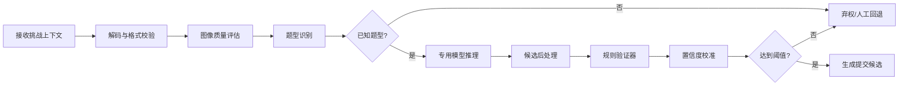

> 理论基础第 2 篇：模型不是终点。训练、推理、置信度门控和评测指标共同决定系统是否可用。

## 摘要

上一篇解决了“问题是什么”和“数据怎么建”。这一篇讨论工程落地：

- 如何从轻量基线开始训练；
- 如何处理难例、增强和分布漂移；
- 如何校准置信度并设计弃权；
- 如何把模型放进真实推理链路；
- 如何用图片级、挑战级和统计显著性指标评价系统。

核心结论是：**一个能可靠说“不确定”的模型，通常比一个过度自信的模型更适合生产。**

> **研究边界**：本文只讨论授权环境中的模型训练、评测与工程架构，不提供第三方产品未公开的协议、核心算法或绕过实现。

---

## 1. 训练流程：一条可复现的路线

### 阶段 0：数据审计

- 去重：精确哈希 + 感知哈希；
- 泄漏检查：会话、模板、文件名、EXIF；
- 标签审计：空标签、越界框、答案冲突；
- 分布统计：题型、尺寸、语言、采集时间；
- 建立固定验证集和“时间外推集”。

### 阶段 1：轻量基线

目标不是追求最高分，而是建立可重复的下限：

- 冻结主干，只训练分类头；
- 使用交叉熵或 focal loss 处理类别不平衡；
- 记录每类 precision/recall；
- 输出混淆矩阵和失败样本；
- 固定随机种子、数据版本和模型版本。

### 阶段 2：难例与增强

当基线稳定后，再引入增强：

- JPEG 压缩、缩放、轻度模糊；
- 亮度、对比度、色偏；
- 小角度旋转、透视变化；
- 遮挡和局部裁剪；
- 噪声与屏幕拍摄模拟。

避免使用会破坏语义的过度增强。比如把目标裁掉、把文字扭曲到不可读，只会制造标签噪声。

难例挖掘建议按以下顺序进行：

1. 模型高置信度错误；
2. 低置信度但正确的样本；
3. 新模板/新题型样本；
4. 长尾类别样本；
5. 图像质量边界样本。

### 阶段 3：校准与阈值

- 在独立校准集上拟合温度；
- 分题型报告 ECE 和 Brier score；
- 选择满足误接受率约束的最小弃权率阈值；
- 为每个题型设置独立阈值；
- 记录阈值版本，确保可回滚。

### 阶段 4：压力测试

不要只测“干净验证集”。至少覆盖：

- 不同浏览器和操作系统渲染差异；
- 不同网络质量与图片压缩；
- 多语言指令；
- 不同屏幕尺寸和 DPR；
- 新模板版本；
- 多帧序列中的丢帧与延迟；
- 高峰期并发和队列积压；
- 服务端限流和超时。

### 1.1 训练配置示例

以下配置仅表达工程思路，不绑定具体框架：

```yaml
experiment: funcaptcha-vision-baseline
data:
  train_manifest: s3://authorized-bucket/manifests/train.jsonl
  val_manifest: s3://authorized-bucket/manifests/val_grouped.jsonl
  split_key: session_id_hash
  image_size: 384
model:
  backbone: convnext_tiny
  heads:
    family: 6
    semantic: 32
    bbox: 4
  dropout: 0.1
training:
  epochs: 30
  batch_size: 64
  optimizer: adamw
  lr: 3.0e-4
  weight_decay: 0.05
  amp: true
evaluation:
  primary_metric: challenge_success_rate
  guardrails:
    false_accept_rate_max: 0.01
    p95_latency_ms_max: 250
```

实际参数应根据数据规模、硬件和延迟预算调整。配置应纳入版本控制，训练脚本应记录数据哈希、代码提交和随机种子。

---

---

## 2. 推理编排：把模型放进真实链路

### 2.1 推理流水线



### 2.2 延迟预算

一个可操作的预算示例：

| 阶段 | 目标耗时 | 说明 |
|---|---:|---|
| 图像下载/解码 | 30–80 ms | 受网络和图片大小影响 |
| 质量检查 | 5–20 ms | 可并行执行 |
| 题型识别 | 10–40 ms | 轻量模型 |
| 专用模型 | 80–250 ms | 取决于模型和硬件 |
| 后处理与验证 | 5–20 ms | 规则和 schema 校验 |
| 网络与排队 | 50–500 ms | 受服务端和并发影响 |

预算应分层设置：P50 用于容量规划，P95/P99 用于告警和用户体验。不要把平均值当成 SLA。

### 2.3 并行化

以下步骤适合并行：

- 图像质量检查与题型识别；
- 多候选裁剪的分类；
- OCR 与目标检测的局部区域分析；
- 多个轻量模型的集成推理。

以下步骤不适合盲目并行：

- 依赖前一步结果的交互动作；
- 需要保证顺序的多步提交；
- 需要服务端状态确认的重试。

### 2.4 失败分类

建议统一失败原因编码，便于聚合分析：

```text
LOAD_TIMEOUT
DECODE_ERROR
LOW_QUALITY
UNKNOWN_FAMILY
LOW_CONFIDENCE
INVALID_OUTPUT_SCHEMA
CHALLENGE_EXPIRED
TOKEN_REJECTED
RATE_LIMITED
UPSTREAM_UNAVAILABLE
USER_ABORTED
```

在日志中记录原因编码和脱敏后的上下文，不记录原始 token、完整图像或可识别个人的信息。

---

---

## 3. 评测体系：让数字可被相信

### 3.1 指标定义

设：

- `N_issued`：下发的挑战数；
- `N_success`：服务端校验通过的挑战数；
- `N_attempt`：提交次数；
- `N_false_accept`：错误答案被接受的数量；
- `N_negative`：负样本总数。

则：

```text
Challenge Success Rate = N_success / N_issued
Attempt Efficiency     = N_success / N_attempt
False Accept Rate      = N_false_accept / N_negative
```

对于二项比例，建议使用 Wilson 置信区间，而不是只报告一个点估计。小样本下尤其重要。

### 3.2 评测矩阵

| 维度 | 切片示例 | 目的 |
|---|---|---|
| 题型 | 语义选择、定位、排序、OCR | 发现某个题型的系统性退化 |
| 模板 | family + version | 检测新模板带来的漂移 |
| 时间 | 天、周、版本发布前后 | 识别分布变化 |
| 语言 | zh-CN、en-US 等 | 检查指令理解与本地化差异 |
| 设备 | 桌面、移动端、DPR | 检查渲染和裁剪差异 |
| 图像质量 | 清晰、压缩、模糊、遮挡 | 评估鲁棒性 |
| 交互长度 | 1 步、2–3 步、多步 | 评估误差累积 |
| 并发 | 低峰、高峰、限流 | 评估队列与超时 |

### 3.3 离线与在线指标要分开

- **离线**：图片级准确率、题型准确率、FAR、校准误差、推理延迟。
- **在线**：挑战成功率、服务端拒绝率、平均尝试次数、人工回退率、用户放弃率、端到端延迟。

离线指标用于模型选择，在线指标用于系统决策。不要用离线准确率直接承诺线上成功率。

### 3.4 统计显著性

比较两个模型或两套阈值时，至少做：

- 固定同一验证集和同一会话分组；
- 对挑战级结果做 bootstrap；
- 报告差值及其置信区间；
- 检查关键切片是否出现退化；
- 避免只挑选表现最好的切片做汇报。

如果 A 模型总体提升 1%，但在新模板切片下降 8%，这不是一个可以忽略的细节。

---

---

## 4. 安全、隐私与合规

### 4.1 数据最小化

- 只采集完成任务所必需的图像和上下文；
- 原始图像设置短保留期；
- 训练数据去标识化；
- 访问使用最小权限和审计日志；
- 禁止把生产 token、Cookie 或用户凭据写入训练集。

### 4.2 授权与用途限制

在自有系统或书面授权环境中，图像识别可以用于：

- 验证挑战组件的可用性和无障碍体验；
- 质量保障与回归测试；
- 研究模型鲁棒性和误判模式；
- 评估第三方组件的集成质量。

不应将其用于绕过他人站点的访问控制、批量创建账号、窃取数据或规避计费。

### 4.3 人工回退

任何自动化识别系统都应设计人工回退路径。对于无障碍用户、低质量设备或高风险操作，回退不是失败，而是系统安全设计的一部分。

---

---

## 5. 上线检查清单

### 数据

- [ ] 已按 session 分组切分；
- [ ] 已按模板版本切分；
- [ ] 已做重复和答案泄漏审计；
- [ ] 已建立时间外推集；
- [ ] 已记录数据版本和哈希。

### 模型

- [ ] 有轻量基线；
- [ ] 有题型路由；
- [ ] 有置信度校准；
- [ ] 有弃权策略；
- [ ] 有规则验证器；
- [ ] 有失败样本回放能力。

### 评测

- [ ] 报告图片级和挑战级指标；
- [ ] 报告 FAR、弃权率和 P95 延迟；
- [ ] 覆盖新模板、语言、设备和图像质量切片；
- [ ] 比较模型时报告置信区间；
- [ ] 有在线影子模式或灰度发布。

### 运维

- [ ] 记录脱敏后的失败原因；
- [ ] 监控题型分布和置信度漂移；
- [ ] 设置超时、限流和熔断；
- [ ] 有模型版本回滚方案；
- [ ] 有人工回退和应急联系人。

---

---

## 6. 常见误区

**误区一：只追求测试集准确率。**  
挑战题型的价值在于分布不断变化。没有分组切分和时间外推，准确率很可能只是记忆模板。

**误区二：把置信度当成概率。**  
未校准的 softmax 分数不能直接用于业务阈值。必须在独立数据上校准并分题型验证。

**误区三：所有失败都重试。**  
过期、重放、策略拒绝和网络错误需要不同的恢复策略。错误重试会放大限流和成本。

**误区四：模型输出后立即提交。**  
缺少 schema 校验、规则验证和业务上下文检查，会把低级错误送到服务端。

**误区五：把日志当成调试垃圾桶。**  
token、图像和用户标识可能包含敏感信息。日志应默认脱敏，并设置保留期限。

---

---

## 本篇小结

把视觉模型做成工程系统，需要把四个层次分开：

1. **模型层**：解决分类、检测、OCR 或序列任务；
2. **决策层**：处理置信度、弃权、验证器和阈值；
3. **系统层**：处理推理延迟、并发、超时和失败分类；
4. **评测层**：用会话级指标、切片和置信区间判断是否真的改进。

下一篇将转向协议工程，讨论挑战状态机、服务端校验和可观测性如何把视觉识别接入完整的信任链。

---

*说明：本文讨论授权范围内的人机验证视觉任务与工程评测方法；具体产品能力、接口和实现以官方文档、合同及当地法律为准。*
